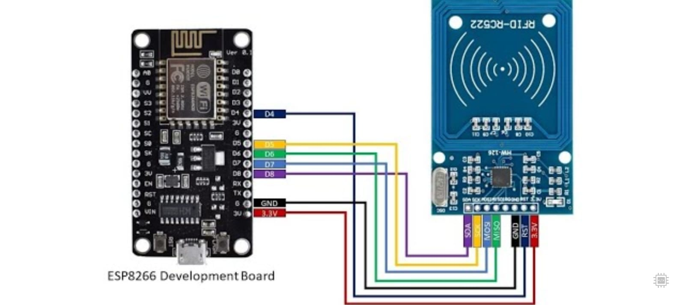
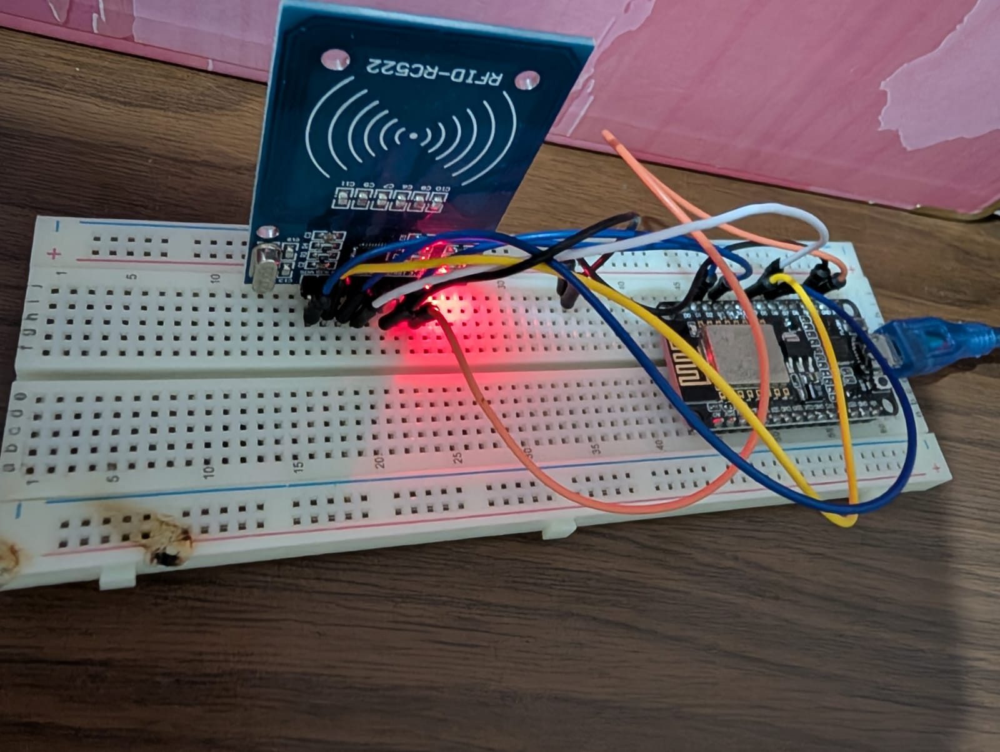

# Câblage RFID RC522 — ESP8266 NodeMCU

## Matériel requis

- ESP8266 NodeMCU v1.0 (ESP-12E)
- Lecteur RFID RC522
- Câbles Dupont femelle-femelle
- Carte ou badge RFID 13.56 MHz

## Schéma de connexion

| RC522 Pin | ESP8266 Pin | Description         |
|-----------|-------------|---------------------|
| SDA (SS)  | D2 (GPIO4)  | Chip Select         |
| SCK       | D5 (GPIO14) | Clock SPI           |
| MOSI      | D7 (GPIO13) | Master Out Slave In |
| MISO      | D6 (GPIO12) | Master In Slave Out |
| IRQ       | Non connecté| Interruption        |
| GND       | GND         | Masse               |
| RST       | D4 (GPIO2)  | Reset               |
| 3.3V      | 3V3         | Alimentation        |

## Important

- Alimenter le RC522 en **3.3V UNIQUEMENT**
- Ne jamais connecter en 5V → destruction du module
- Utiliser des câbles Dupont courts pour éviter les interférences

## Photo du montage

## Photo réelle du montage

